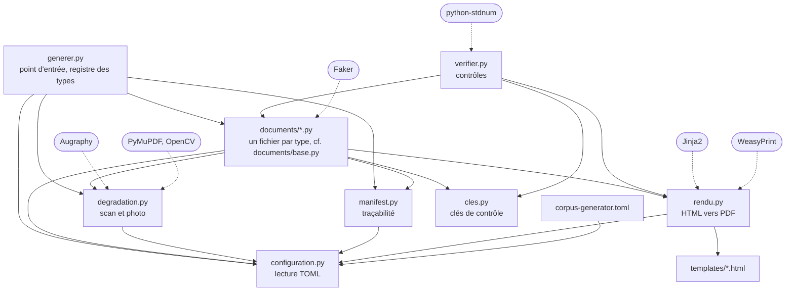
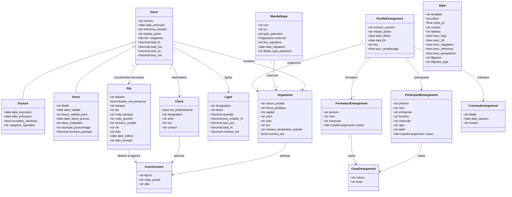
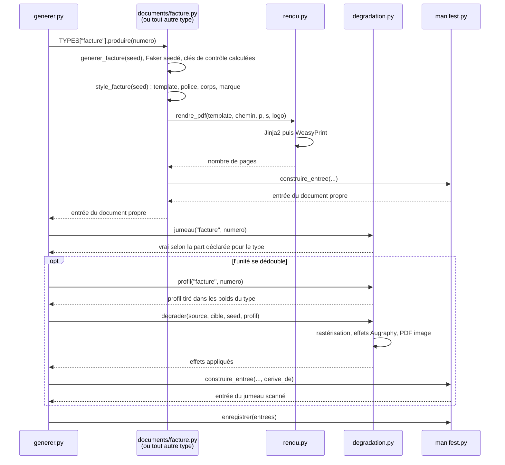

# CorpusGenerator

Fabrique les documents du corpus de test : des PDF français réalistes, entièrement inventés, accompagnés d'un manifest qui décrit chacun d'eux.

Aucune donnée personnelle réelle n'entre ni ne sort d'ici. Les identifiants produits (IBAN, SIREN, SIRET, TVA) portent des clés de contrôle justes, mais ne désignent personne.

## Exécuter avec Docker

Depuis le dossier `CorpusGenerator` :

```bash
docker compose build
docker compose run --rm generator

# Contrôler
docker compose run --rm --entrypoint python generator manifest.py
docker compose run --rm --entrypoint python generator verifier.py
```

Le corpus est écrit directement dans `Detect-Doc/corpus` grâce au volume défini dans `compose.yaml`. `Detect-Doc/docs` est monté pour la même raison : la génération y réécrit la composition du corpus. Le fichier TOML local est monté en lecture seule dans le conteneur.

Le conteneur tourne sous l'uid 1000 et non sous `root`, sans quoi il laisserait dans `corpus/raw/` des fichiers qu'une exécution suivante hors Docker ne pourrait plus remplacer. Les deux modes s'alternent donc librement sur le même corpus.

## Exécuter sans Docker

Sans Docker, l'outil tourne sous WSL, pas directement sous Windows : WeasyPrint dépend des bibliothèques GTK (Pango, Cairo) qui n'existent pas nativement sous Windows.

```bash
# Prérequis système, une fois. La liste des polices doit rester alignée sur celle du
# Dockerfile et sur les listes de documents/commun.py et documents/carte_visite.py :
# `verifier.py` échoue si l'une manque.
sudo apt-get install python3-venv libpango-1.0-0 libpangoft2-1.0-0 \
                     libgl1 libxcb1 \
                     poppler-utils fonts-liberation fonts-dejavu-core \
                     fonts-crosextra-carlito fonts-crosextra-caladea \
                     fonts-croscore fonts-urw-base35 fonts-noto-core \
                     fonts-cabin fonts-comfortaa fonts-dosis fonts-inter \
                     fonts-lato fonts-league-spartan fonts-open-sans \
                     fonts-quicksand fonts-roboto-slab \
                     fonts-breip fonts-femkeklaver fonts-kristi fonts-tlwg-purisa

# Environnement Python, une fois
python3 -m venv .venv
.venv/bin/pip install -r requirements.txt

# Produire tous les documents déclarés dans le TOML
.venv/bin/python generer.py

# Contrôler
.venv/bin/python manifest.py
.venv/bin/python verifier.py
```

## Configuration globale

`corpus-generator.toml` décide de toute la composition du corpus. Il se lit sur **trois étages**, du plus général au plus précis, et le plus précis gagne :

| Étage | Table | Ce qu'elle règle |
|---|---|---|
| génération entière | `corpus` | dossier de sortie, seed globale, réécriture de la composition |
| | `split` | répartition entre jeu de réglage et jeu de mesure |
| | `degradation` | interrupteur général de la numérisation, résolution, qualité JPEG |
| valeur de tout type qui ne dit rien | `defaults` | les quatre réglages ci-dessous, tous obligatoires ici |
| propre à un type | `types.<nom>` | ceux de ces quatre réglages qui diffèrent du défaut |

| Réglage d'un type | Effet |
|---|---|
| `count` | documents écrits au manifest, jumeaux numérisés compris ; `0` retire le type |
| `scanned_share` | part de ses documents qui sortent numérisés, en pourcentage |
| `rotated_share` | part de ses documents numérisés posés de travers d'un quart de tour |
| `profiles` | poids des profils de numérisation qui peuvent lui arriver |

Les quatre s'héritent, effectif compris : **un bloc de type vide est légal** et vaut le corpus par défaut. Un type n'écrit donc que ce qui le distingue, et la table `types` se lit comme la liste des particularités du corpus. Le bloc, lui, reste obligatoire même vide : c'est lui qui déclare qu'un type entre au corpus, et un type enregistré dans `generer.py` mais absent d'ici fait échouer la génération plutôt que de disparaître en silence.

Les effectifs comptent les documents écrits au manifest. Un type dont les unités se dédoublent en un jumeau numérisé voit son nombre d'unités ajusté pour tomber exactement sur le compte demandé, jamais l'inverse.

Changer ces effectifs suffit : la génération réécrit le manifest, puis la composition du corpus dans `Detect-Doc/docs/corpus.md`, entre les balises `composition:debut` et `composition:fin`. Le reste de ce fichier est de la prose, écrite à la main, qui n'est jamais touchée. `write_composition = false` laisse la documentation intacte, le temps d'un essai.

Les chemins relatifs sont résolus depuis le fichier TOML. Ce qui n'est pas là relève de la présentation des documents et vit dans le code : templates, listes de polices, blocs affichés par chaque style, et les paramètres détaillés de chaque effet Augraphy, qui définissent l'implémentation des profils.

Une clé inconnue, un type inconnu ou sans bloc, un profil sans fabrique ou un réglage sans effet sur le type qui le porte font échouer la génération avec un message qui nomme la ligne fautive : `rotated_share` sur une facture, `profiles` sur une offre d'emploi, `scanned_share` au-delà de 50 sur un type qui conserve son original. Dans un fichier où presque tout est facultatif, un réglage silencieux se croirait appliqué pendant des semaines.

Chaque ligne du manifest porte `configuration_sha256`, l'empreinte du TOML utilisé, seed globale comprise. La reproductibilité dépend du code, de la configuration et des versions des dépendances. À ces éléments identiques, une nouvelle exécution réécrit les mêmes fichiers octet pour octet ; changer `seed` produit à l'inverse un second corpus entièrement indépendant du premier, à effectifs et à réglages inchangés.

## Qui utilise quoi



Les dépendances vont toutes dans le même sens, sans cycle. `cles.py` ne dépend de rien et `configuration.py` ne dépend que de la bibliothèque standard, ce qui lui permet d'être importé de partout, seed globale et réglages compris. `manifest.py` non plus ne dépend jamais de `documents/` : il doit rester utilisable seul, pour valider un corpus déjà produit sans importer WeasyPrint ni Augraphy.

`degradation.py` répond aussi aux questions de composition : quels documents sont numérisés, sous quel profil, et comment un objet physique a été repris. Les types de `documents/` les lui posent plutôt que de lire le TOML eux-mêmes, pour que la règle n'existe qu'à un seul endroit.

Chaque type de document vit dans son propre fichier sous `documents/`, avec son modèle de données, sa présentation et sa production du manifest : cf. `documents/base.py` pour le patron commun, et la section [Faire évoluer](#faire-évoluer) pour l'ajout d'un type. `documents/commun.py` porte ce que plusieurs types partagent (identité de l'organisme et du client, vocabulaire du secteur, présentation d'une pièce comptable) ; `documents/piece.py` porte le tronc commun propre à la facture et au devis. Rien n'empêche un type de ne dépendre d'aucun des deux.

## La paire facture et devis

Les deux types partagent leurs quatre templates, `piece_01.html` à `piece_04.html`, et le tronc commun `Piece` du modèle de données. Ce n'est pas une économie de code, c'est la condition pour que le corpus mesure quelque chose : un organisme édite son devis et sa facture avec le même logiciel, donc sur le même papier à en-tête. Leur donner des mises en page distinctes offrirait un raccourci visuel qui n'existe pas en production, et un classifieur entraîné dessus s'effondrerait sur des documents réels.

Ce qui les sépare tient donc entièrement au texte, et c'est exactement ce que la détection devra apprendre à lire.

| Sur le devis seulement | Sur la facture seulement |
|---|---|
| intitulé `Devis`, `Proposition commerciale` ou `Offre de prix` | intitulé `Facture` |
| durée de validité et date limite d'acceptation | date d'échéance de paiement |
| date de début prévue, postérieure à l'émission | date d'exécution, antérieure à l'émission |
| mention de gratuité du devis | pénalités de retard et indemnité de 40 € |
| acompte à la commande | mentions de la réforme de la facturation électronique |
| convention de formation annoncée pour après acceptation | référence de la convention déjà signée |
| cartouche « Bon pour accord » à dater et signer | tampon `PAYÉE`, `ACQUITTÉE` ou `RÉGLÉE` |

Tout le reste est commun : émetteur, destinataire, tableau des lignes, totaux HT et TTC, coordonnées bancaires, numéro de déclaration d'activité, exonération de TVA.

Les cas volontairement difficiles sont ceux où ces marqueurs s'effacent : un devis intitulé `Offre de prix`, sans cartouche d'acceptation et portant un RIB, ne se distingue plus d'une facture que par ses dates et sa durée de validité. Les tags du manifest (`devis`, `proposition`, `offre`, `cartouche-accord`, `acompte`) permettront de mesurer le poids réel de chacun.

## La feuille d'émargement

`FEUILLE_EMAR` est produit dans cinq structures qui correspondent aux familles observées dans les exemples métier :

| Famille | Structure de la grille |
|---|---|
| séance unique | participants en lignes, signatures matin et après-midi |
| multi-jours | participants en lignes, une colonne par demi-journée |
| récapitulatif mensuel | stagiaires en colonnes, dates en lignes, suivi des heures |
| feuille collective | journées en colonnes et total d'heures par participant |
| officiel sectoriel | tables séparées pour l'intervenant et les participants, créneau soirée, identifiants RPPS et ADELI |

Le titre est tiré séparément de la structure et peut être absent. Les colonnes métier, la clause d'attestation, le cachet, la référence d'OPCO et la consigne Qualiopi varient indépendamment. Le bloc formateur aussi, sauf sur le formulaire sectoriel qui consacre une table entière à son intervenant. Les cases portent une signature, une annotation manuscrite, une barre ou restent vides, et le taux de remplissage effectif est écrit dans le manifest. Seuls les créneaux signés ou pris en retard comptent dans les heures suivies : une case barrée, un `ABSENT` ou une case vide ne se facturent pas.

Les signatures sont des tracés vectoriels produits par `paraphe_svg`, jamais un nom écrit dans une police manuscrite. Une signature en police cursive resterait du texte : sur un PDF à texte natif, un copier-coller livrerait le nom du signataire, ce qu'aucune feuille signée à la main ne fait, et le service apprendrait une régularité qui n'existe pas en production. `verifier.py` rend une feuille de chaque famille et échoue si un paraphe se retrouve dans le texte extrait. Les annotations, elles, restent du texte : un `ABSENT` porté au stylo est précisément ce que l'OCR doit savoir lire.

Le document final suit l'un des trois régimes observés : PDF à texte natif, scan à plat ou photo au smartphone. Une partie des scans est conservée tournée de 90 ou 270 degrés et plusieurs documents comptent deux ou trois pages. Comme pour une carte de visite, le rendu propre n'est qu'une étape de fabrication lorsque la feuille est numérisée : une seule entrée autonome représente le document réellement déposé.

## L'offre d'emploi

`OFF_STAG_EMP` n'est jamais un document de bureau : c'est la capture d'une page web de site d'emploi, imprimée en PDF depuis un navigateur. Cinq templates sans tronc commun de mise en page couvrent les familles observées sur les vingt-quatre exemples métier distincts, eux-mêmes répartis sur dix plateformes sources :

| Template | Ce qu'il imite |
|---|---|
| institutionnel | service public de l'emploi, bloc de métadonnées à droite, bruit de fin de document dont le contrat affiché peut mentir sur la nature réelle du poste |
| jobboard commercial | barre de recherche, formulaire de candidature intégré au document |
| réseau professionnel | deux colonnes, compteur de vues, contact nominatif avec sa photo |
| portail RH bilingue | bandeau de cookies RGPD, libellés en anglais, jamais de contact nominatif |
| éditorial et jeune | bandeau de cookies répété sur chaque page, portrait d'un collaborateur, suggestions d'articles de blog |

Le type de contrat affiché ne suffit pas à lui seul : sur le template institutionnel, un apprentissage ou un contrat de professionnalisation peut être étiqueté « CDD » ou « Intérim » dans le bloc métadonnées, comme observé sur trois offres France Travail réelles. Le bruit de fin de document, offres similaires ou postes suggérés, mélange librement d'autres types de contrat et d'autres métiers.

Une part réglable des offres, un sixième des exemples réels, sort en **capture d'écran nette**, sans aucune couche texte, à la différence des autres types du corpus : ce n'est pas la reprise dégradée d'un objet physique, seule la couche texte disparaît, le rendu reste net. `documents/offre.py` porte donc `autonome = True` plutôt que `physique = True` : contrairement à la carte de visite, ce n'est pas la reprise d'un objet, et contrairement à la facture, il n'existe jamais deux versions du même document. `degradation.capturer_ecran` réutilise la rastérisation et l'écriture reproductible de `degrader`, sans chaîne Augraphy ni catalogue de profils.

## Le RIB, le mandat SEPA et leur fusion

`RIB`, `SEPA` et `RIB_SEPA` forment le groupe de quasi-synonymes le plus dur du corpus : `RIB_SEPA` est l'union littérale des deux autres. Le RIB montre le pavé de codes établissement/guichet/compte/clé, l'IBAN et le BIC, jamais de cartouche de mandat. Le mandat isolé montre le cartouche RUM et ICS, la clause d'autorisation et la signature du débiteur, jamais le pavé de codes. `RIB_SEPA` montre les deux à la fois : c'est la seule règle qui les sépare, détaillée dans `docs/types-documentaires.md`.

Le RIB (`documents/rib.py`, `templates/rib_01.html`) reste indépendant : sa dataclass `Rib` sert aussi de pavé de coordonnées bancaires embarqué en pied de facture ou de devis. Le mandat et sa variante fusionnée partagent tout, modèle de données et style dans `documents/mandat.py`, un seul template `templates/mandat_sepa_01.html` : le booléen `avec_pave_rib` du style choisit lequel des deux types est rendu, exactement comme `documents/piece.py` fait déjà varier quelques blocs pour distinguer la facture du devis sur les mêmes quatre templates.

Le débiteur du mandat, tiré via `generer_rib`, et son créancier, tiré via `generer_organisme`, portent chacun un décalage de seed propre (1000 et 1500) pour ne jamais réutiliser l'organisme ou le RIB d'une facture, d'un devis ou d'un RIB isolé de même numéro, sur le modèle du décalage de 500 déjà appliqué entre facture et devis.

L'ICS porte ses deux chiffres de contrôle calculés par `cles.identifiant_creancier_sepa`, avec le même algorithme ISO 7064 MOD 97-10 que l'IBAN. Comme pour la feuille d'émargement, la signature du débiteur est un tracé produit par `paraphe_svg`, jamais du texte en police cursive : un mandat déposé en gestion documentaire est signé, et un copier-coller ne doit jamais en révéler le nom.

## Le modèle de données



`Style` n'est rattaché à aucun document : il est choisi séparément à partir de la même seed, puis passé au template à côté du document. Un `Rib` mène une double vie, comme document à part entière et comme pavé de coordonnées bancaires au bas d'une pièce. `MandatSepa` n'a pas de lien formel vers le `Rib` de son débiteur : les deux sont générés séparément puis passés ensemble au template, qui les assemble au rendu plutôt que le modèle de données.

Le devis n'est pas tiré sur la même seed que la facture de même numéro. Sans ce décalage, `dev-0001` et `fac-0001` sortiraient avec le même organisme, le même client et les mêmes montants : le corpus contiendrait des paires de quasi-jumeaux textuels, et la matrice de confusion mesurerait un cas de figure qui n'existe pas en production.

## Ce qui se passe pour un document



La seed pilote tout : le contenu, la présentation, la dégradation et la répartition entre le jeu de réglage et le jeu de mesure. Rien n'est tiré au hasard sans elle.

Chaque facette tire dans un **flux nommé** distinct, `configuration.flux("mandat", seed)` par exemple. C'est indispensable : plusieurs facettes dérivées d'un même `seed % 4` finiraient par s'aligner, et le jeu de réglage se retrouverait réduit à une seule mise en page. La **seed globale du TOML** entre dans le nom de chaque flux et dans la valeur passée à Faker, ce qui suffit à décorréler entièrement deux corpus tirés sur deux seeds : ce n'est pas un décalage des numéros, le passage par un hachage redistribue tout.

## Les deux jeux

Le jeu **dev** sert au réglage du prompt et de l'OCR, et c'est le seul qu'on s'autorise à ouvrir document par document. Le jeu **test** ne s'ouvre qu'aux jalons de mesure : régler sur les documents qui servent à noter donnerait un chiffre optimiste, qui s'effondrerait en production.

La répartition est **stratifiée par type et par bloc de `dev_every` unités consécutives** : dans chaque bloc, une unité et une seule part en dev. Chaque type reçoit ainsi sa part exacte, garantie dès le premier bloc complet. Une répartition tirée globalement laissait les types à faible effectif sans aucun document de réglage, précisément ceux du groupe bancaire dont les règles de désambiguïsation sont les plus difficiles à écrire.

La position de l'unité dans son bloc reste tirée, dans un flux qui inclut le type : une règle purement modulaire s'alignerait sur les facettes qui tournent déjà sur le même modulo, et un flux commun à tous les types leur imposerait les mêmes rangs. Le bloc ne dépendant que du rang, allonger un type ne redistribue jamais les blocs déjà constitués.

Un document et son jumeau scanné tombent toujours dans le même jeu, l'entrée dérivée recopiant celle de son original. Les séparer ferait fuiter le contenu du jeu de réglage dans le jeu de mesure, et le validateur du manifest le refuse.

## Les deux régimes

Chaque type déclare sa part de documents numérisés, `scanned_share`, et les poids des profils qui peuvent lui arriver. Un type qui conserve son original, facture, devis, RIB et mandats, y arrive en dédoublant une partie de ses unités en un **jumeau numérisé**, produit en rastérisant le PDF propre puis en lui appliquant les défauts d'une chaîne d'impression et de numérisation réelle. Les deux versions coexistent dans le corpus, reliées par le champ `derive_de`. Une unité ne produisant jamais plus d'un jumeau, la part de ces types plafonne à 50 %.

La règle porte sur le rang du document et non sur un tirage : chaque type reçoit exactement la part déclarée, à l'arrondi près sur les petits effectifs, et le nombre de paires est connu avant la génération. Un tirage laisserait chaque type dériver de son côté, et un type moins bien classé qu'un autre serait alors impossible à départager de sa part de numérisations.

| Profil | Ce qu'il simule |
|---|---|
| `scan-propre` | numérisation correcte sur matériel entretenu |
| `scan-degrade` | rouleaux sales, encre qui bave, compression agressive |
| `photocopie` | copie de copie, caractères rongés, tambour sale |
| `photo-smartphone` | éclairage inégal, ombre portée, cadrage de travers |
| `fax` | binarisation brutale et lignes manquantes |

La table `profiles` d'un type remplace celle par défaut sans se fusionner avec elle : un profil qu'elle ne cite pas ne lui arrive jamais. C'est ainsi qu'une feuille d'émargement n'est jamais faxée, et qu'une carte de visite est photographiée une fois sur deux.

Comparer un résultat sur un document propre et sur son jumeau isole exactement ce que la reconnaissance de caractères coûte en qualité, sur un contenu strictement identique. Les deux régimes doivent donc rester bien représentés : sans documents propres il n'y a plus de référence, sans documents dégradés on ne mesure pas l'OCR du tout. `enabled = false` sous `[degradation]` les supprime tous d'un coup, ce qui divise le temps de génération et n'a d'intérêt que pour itérer sur les templates.

### Les types repris d'un objet physique

Certains types ne se déposent presque jamais sous leur forme bureautique initiale. Une carte de visite reprend un carton, une feuille d'émargement reprend une feuille signée à la main. On les photographie ou on les scanne. Ces types portent `physique = True` sur leur classe dans `documents/`, et leur rendu propre n'est qu'une étape de fabrication, écrasée par sa numérisation. Ils n'ont donc **ni jumeau ni `derive_de`** : une seule entrée au manifest par unité, là où les autres types en produisent une ou deux selon la règle de dédoublement.

Ces types connaissent **trois modes d'acquisition**, et le reste de la chaîne les suit.

| Mode | Ce que le document est | Régime |
|---|---|---|
| `photo` | original photographié à la main, éclairage inégal et cadrage de travers | `scanne` |
| `scan` | original passé au scanner, avec bruit et rotation éventuels | `scanne` |
| `fichier` | export bureautique ou graphique, éléments manuscrits incrustés en tracés | `texte-natif` |

`fichier` est minoritaire et indispensable. Le cas existe en production, et un corpus qui n'en contiendrait aucun ne dirait rien de la façon dont le service le traite. C'est le régime sur lequel l'OCR n'a rien à faire. Sa part est le complément de `scanned_share`.

Le mode se déduit du profil tiré, et non l'inverse : `photo-smartphone` est une photo, tout autre profil un passage au scanner. Un seul tirage répond donc aux deux questions, et la table `profiles` du type suffit à régler la proportion de photos. Décider séparément du mode et des défauts produirait des documents que leur propre manifest décrirait de travers, un carton photographié portant les défauts d'un fax.

`rotated_share` fixe enfin la part de ces documents posés de travers d'un quart de tour. Un carton paysage se photographie volontiers en portrait, une feuille se pose en travers sur la vitre du scanner, et un OCR qui ne redresse pas la page n'en lit alors rien : c'est exactement ce que le corpus doit pouvoir révéler.

### Les types autonomes

Un type peut aussi trancher lui-même son régime final sans être la reprise d'un objet physique. C'est le cas de l'offre d'emploi : chaque instance est, dès sa génération, un fichier à texte natif ou une capture d'écran nette, jamais les deux, et jamais un objet qu'on aurait scanné. Ces types portent `autonome = True` sur leur classe, et `generer.py` n'y ajoute ni reprise forcée ni jumeau dégradé : `produire` renvoie l'entrée de manifest définitive.

`scanned_share` y désigne la part de captures d'écran. Aucun profil ne leur est applicable, une capture n'ayant subi aucune impression : déclarer une table `profiles` sur un tel type fait échouer la génération.

## Les polices

Les polices décident de ce que l'OCR voit : elles font partie du corpus au même titre que les templates. `documents/commun.py` déclare les familles bureautiques des pièces comptables et les manuscrites, partagées par plusieurs types ; `documents/carte_visite.py` ajoute les familles d'imprimeur propres à ce seul type.

Deux pannes silencieuses guettent, et `verifier.py` les contrôle. Une police absente du système est remplacée sans un mot par la police de secours, et le corpus sort avec bien moins de variété que le manifest n'en annonce. Un caractère non dessiné est emprunté ailleurs, si bien qu'un nom peut sortir avec un `É` d'un autre corps au milieu d'un mot. Les capitales accentuées sont le vrai piège : la plupart des polices manuscrites libres ne les dessinent pas.

Toute police ajoutée dans `documents/` doit donc l'être aussi au `Dockerfile` et à la commande d'installation plus haut.

## Faire évoluer

**Ajouter une mise en page à la facture et au devis.** Écrire le template dans `templates/`, ajouter une fabrique dans `documents/piece.py` et l'inscrire dans `FABRIQUES_PIECE`. Le template est choisi en tournant sur la seed plutôt qu'au hasard, pour qu'aucune mise en page ne reste sous-représentée sur un corpus de taille modeste.

**Ajouter un type de document.** Créer `documents/mon_type.py` sur le patron des fichiers existants (`documents/base.py` documente l'interface) : le modèle de données, sa génération par Faker à seed fixée, un ou plusieurs styles, une classe `MonTypeDocument(DocumentType)` dont `produire(numero)` rend le PDF et construit l'entrée de manifest, et l'instance `DOCUMENT` en bas du fichier. Puis :

1. écrire le ou les templates dans `templates/` ;
2. enregistrer `DOCUMENT` dans `TYPES` au début de `generer.py` ;
3. ajouter le type à `manifest.TYPES_CONNUS` ;
4. lui ouvrir un bloc `[types.<nom>]` dans le TOML, vide s'il prend tous les défauts.

Si le nouveau type a un voisin confondable déjà présent, comme la facture et le devis, lui faire partager ses templates plutôt que d'en écrire de nouveaux, et voir si un module partagé sur le modèle de `documents/piece.py` a du sens. S'il circule surtout comme reprise d'un objet physique, poser `physique = True` sur sa classe et demander son mode d'arrivée à `degradation.acquisition`. S'il tranche lui-même son régime final sans être la reprise d'un objet, comme l'offre d'emploi, poser `autonome = True` et demander son régime à `degradation.numerise`. Ce qui est utile à au moins deux types va dans `documents/commun.py`, jamais un axe propre à un seul type même s'il y ressemble.

**Ajouter un type dont la page n'est pas le document.** La carte de visite occupe un coin d'une feuille par ailleurs vide. Son template `_carte_page.html` décrit le support, feuille de scanner ou plan de travail, et les trois `carte_0X.html` en héritent pour ne décrire que la face imprimée. Reprendre ce découpage pour tout type dont le support compte autant que le contenu.

Dans les deux cas, reporter l'ajout sur les schémas ci-dessus : ils ne servent qu'à condition de décrire le code tel qu'il est.

**Deux règles à ne pas enfreindre.**

La génération ne doit dépendre que de la seed et d'arithmétique entière. Ni horloge, ni fuseau, ni locale système, ni parcours d'un ensemble non trié. `Faker.date_between` est proscrite pour cette raison : elle passe par des horodatages convertis en heure locale et ne redonne pas le même résultat d'une machine à l'autre.

Ce que le manifest déclare doit correspondre au document. Un filigrane annoncé doit être lisible, une donnée personnelle listée doit être présente. Un manifest qui ment envoie sur une fausse piste tous ceux qui l'exploiteront ensuite.
