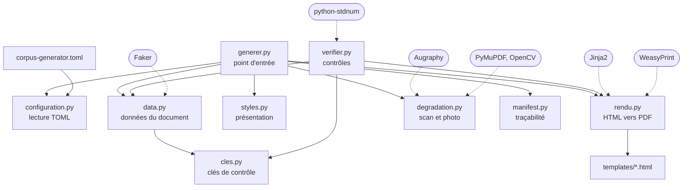
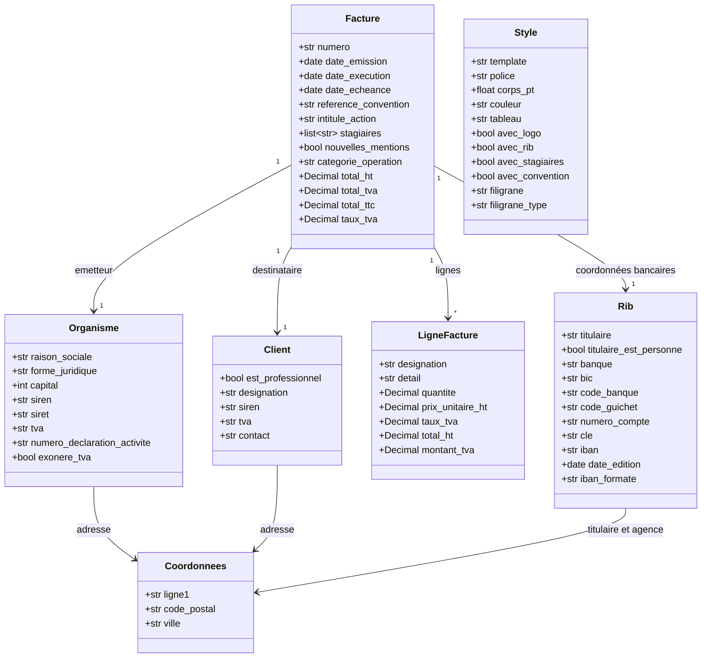
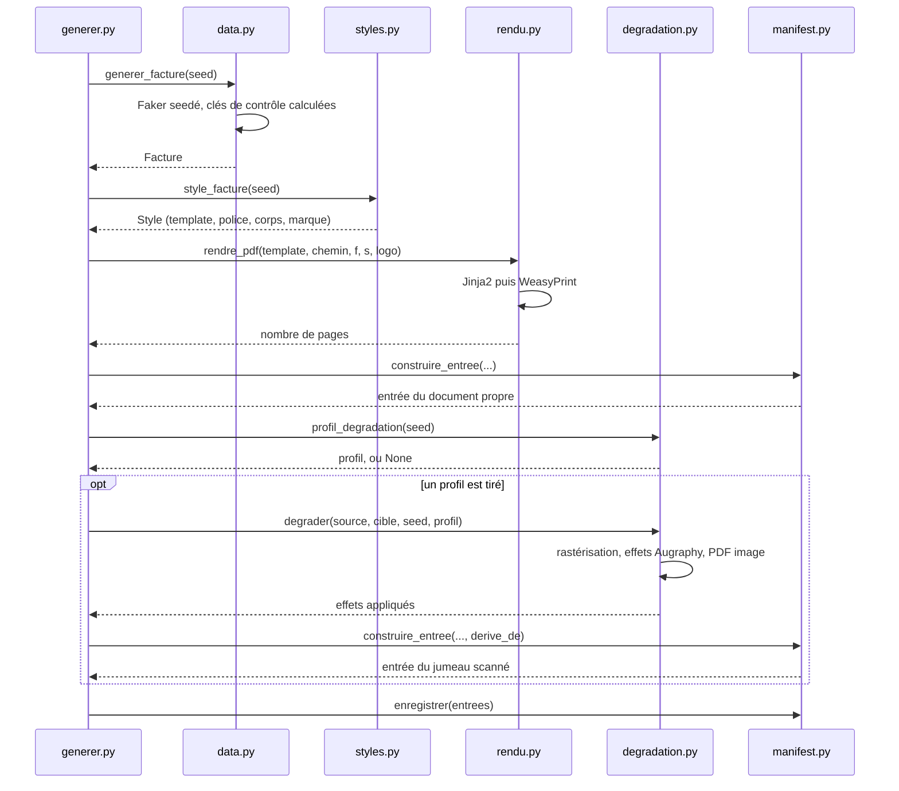

# CorpusGenerator

Fabrique les documents du corpus de test : des PDF français réalistes, entièrement inventés, accompagnés d'un manifest qui décrit chacun d'eux.

Aucune donnée personnelle réelle n'entre ni ne sort d'ici. Les identifiants produits (IBAN, SIREN, SIRET, TVA) portent des clés de contrôle justes, mais ne désignent personne.

## Exécuter

L'outil tourne sous WSL, pas sous Windows : WeasyPrint dépend des bibliothèques GTK (Pango, Cairo) qui n'existent pas nativement sous Windows.

```bash
# Prérequis système, une fois
sudo apt-get install python3-venv libpango-1.0-0 libpangoft2-1.0-0 \
                     poppler-utils fonts-liberation fonts-dejavu-core \
                     fonts-crosextra-carlito fonts-crosextra-caladea \
                     fonts-croscore fonts-urw-base35 fonts-noto-core

# Environnement Python, une fois
python3 -m venv .venv
.venv/bin/pip install -r requirements.txt

# Produire tous les documents déclarés dans le TOML
.venv/bin/python generer.py

# Contrôler
.venv/bin/python manifest.py
.venv/bin/python verifier.py
```

## Configuration globale

`corpus-generator.toml` porte les paramètres qui décrivent le corpus :

| Table | Paramètres |
|---|---|
| `corpus` | dossier de sortie |
| `documents` | nombre de documents propres par type |
| `split` | proportion stable du jeu `dev` |
| `degradation` | proportion de jumeaux, résolution, qualité JPEG |
| `degradation.weights` | poids relatifs des cinq profils |

Les chemins relatifs sont résolus depuis le fichier TOML. Les paramètres détaillés de chaque effet Augraphy restent dans `degradation.py`, car ils définissent l'implémentation des profils.

Chaque ligne du manifest porte `configuration_sha256`, l'empreinte du TOML utilisé. La reproductibilité dépend de la seed, du code, de la configuration et des versions des dépendances. À ces éléments identiques, une nouvelle exécution réécrit les mêmes fichiers octet pour octet.

## Qui utilise quoi



Les dépendances vont toutes dans le même sens, sans cycle. `cles.py` ne dépend de rien et `configuration.py` ne dépend que de la bibliothèque standard.

Deux modules n'ont volontairement aucune connaissance l'un de l'autre : **`data.py` ignore tout de la présentation, et `styles.py` ignore tout du contenu.** C'est ce qui permet de rendre la même facture dans quatre mises en page sans y toucher, et inversement de changer une règle métier sans regarder un seul template.

## Le modèle de données



`Style` n'est rattaché à aucun document : il est choisi séparément à partir de la même seed, puis passé au template à côté du document. Un `Rib` mène une double vie, comme document à part entière et comme pavé de coordonnées bancaires au bas d'une facture.

## Ce qui se passe pour un document



La seed pilote tout : le contenu, la présentation, la dégradation et la répartition entre le jeu de réglage et le jeu de mesure. Rien n'est tiré au hasard sans elle.

Chaque facette tire dans un **flux nommé** distinct, `random.Random(f"split-{seed}")` par exemple. C'est indispensable : plusieurs facettes dérivées d'un même `seed % 4` finiraient par s'aligner, et le jeu de réglage se retrouverait réduit à une seule mise en page.

## Les deux régimes

Un document sur deux environ reçoit un **jumeau scanné**, produit en rastérisant le PDF propre puis en lui appliquant les défauts d'une chaîne d'impression et de numérisation réelle. Les deux versions coexistent dans le corpus, reliées par le champ `derive_de`.

| Profil | Ce qu'il simule |
|---|---|
| `scan-propre` | numérisation correcte sur matériel entretenu |
| `scan-degrade` | rouleaux sales, encre qui bave, compression agressive |
| `photocopie` | copie de copie, caractères rongés, tambour sale |
| `photo-smartphone` | éclairage inégal, ombre portée, cadrage de travers |
| `fax` | binarisation brutale et lignes manquantes |

Comparer un résultat sur un document propre et sur son jumeau isole exactement ce que la reconnaissance de caractères coûte en qualité, sur un contenu strictement identique. Les deux régimes doivent donc rester bien représentés : sans documents propres il n'y a plus de référence, sans documents dégradés on ne mesure pas l'OCR du tout.

Un document et son jumeau tombent toujours dans le même jeu, puisqu'ils partagent la seed. Les séparer ferait fuiter le contenu du jeu de réglage dans le jeu de mesure, et le validateur du manifest le refuse.

## Faire évoluer

**Ajouter une mise en page à un type existant.** Écrire le template dans `templates/`, ajouter une fabrique dans `styles.py` et l'inscrire dans `FABRIQUES_FACTURE`. Le template est choisi en tournant sur la seed plutôt qu'au hasard, pour qu'aucune mise en page ne reste sous-représentée sur un corpus de taille modeste.

**Ajouter un type de document.** Une classe dans `data.py` avec sa fonction de génération, un template, une fabrique de style, une fonction `produire_*` dans `generer.py` inscrite dans `PRODUCTEURS`, et le type ajouté à `TYPES_CONNUS` dans `manifest.py`.

Dans les deux cas, reporter l'ajout sur les schémas ci-dessus : ils ne servent qu'à condition de décrire le code tel qu'il est.

**Deux règles à ne pas enfreindre.**

La génération ne doit dépendre que de la seed et d'arithmétique entière. Ni horloge, ni fuseau, ni locale système, ni parcours d'un ensemble non trié. `Faker.date_between` est proscrite pour cette raison : elle passe par des horodatages convertis en heure locale et ne redonne pas le même résultat d'une machine à l'autre.

Ce que le manifest déclare doit correspondre au document. Un filigrane annoncé doit être lisible, une donnée personnelle listée doit être présente. Un manifest qui ment envoie sur une fausse piste tous ceux qui l'exploiteront ensuite.
