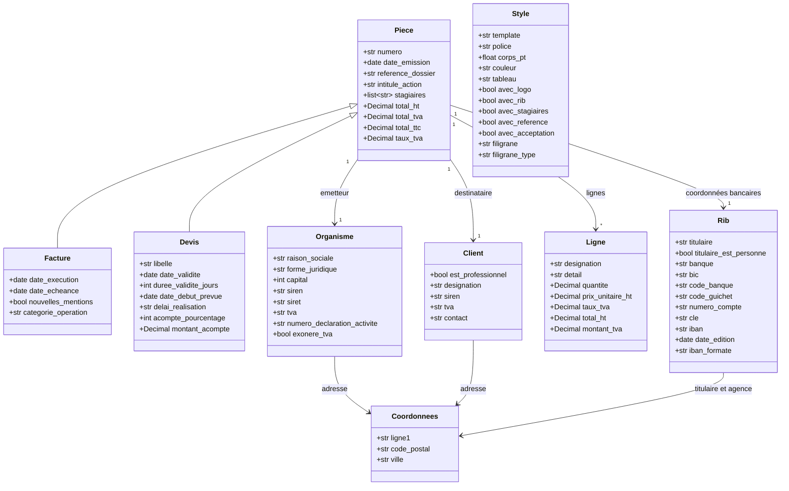
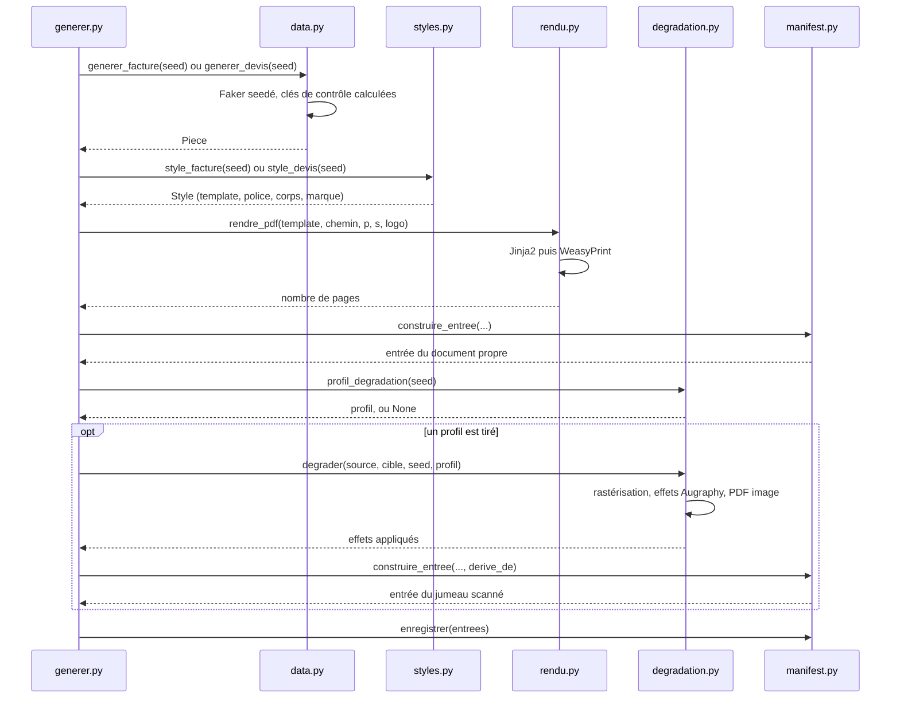

# CorpusGenerator

Fabrique les documents du corpus de test : des PDF français réalistes, entièrement inventés, accompagnés d'un manifest qui décrit chacun d'eux.

Aucune donnée personnelle réelle n'entre ni ne sort d'ici. Les identifiants produits (IBAN, SIREN, SIRET, TVA) portent des clés de contrôle justes, mais ne désignent personne.

## Exécuter avec Docker

Depuis le dossier `CorpusGenerator` :

```bash
docker compose build
docker compose run --rm generator

# Contrôler
docker compose run --rm --entrypoint python generator manifest.py
docker compose run --rm --entrypoint python generator verifier.py
```

Le corpus est écrit directement dans `Detect-Doc/corpus` grâce au volume défini dans `compose.yaml`. Le fichier TOML local est monté en lecture seule dans le conteneur.

Le conteneur tourne sous l'uid 1000 et non sous `root`, sans quoi il laisserait dans `corpus/raw/` des fichiers qu'une exécution suivante hors Docker ne pourrait plus remplacer. Les deux modes s'alternent donc librement sur le même corpus.

## Exécuter sans Docker

Sans Docker, l'outil tourne sous WSL, pas directement sous Windows : WeasyPrint dépend des bibliothèques GTK (Pango, Cairo) qui n'existent pas nativement sous Windows.

```bash
# Prérequis système, une fois. La liste des polices doit rester alignée sur celle du
# Dockerfile et sur les listes de styles.py : `verifier.py` échoue si l'une manque.
sudo apt-get install python3-venv libpango-1.0-0 libpangoft2-1.0-0 \
                     poppler-utils fonts-liberation fonts-dejavu-core \
                     fonts-crosextra-carlito fonts-crosextra-caladea \
                     fonts-croscore fonts-urw-base35 fonts-noto-core \
                     fonts-cabin fonts-comfortaa fonts-dosis fonts-inter \
                     fonts-lato fonts-league-spartan fonts-open-sans \
                     fonts-quicksand fonts-roboto-slab \
                     fonts-breip fonts-femkeklaver fonts-kristi fonts-tlwg-purisa

# Environnement Python, une fois
python3 -m venv .venv
.venv/bin/pip install -r requirements.txt

# Produire tous les documents déclarés dans le TOML
.venv/bin/python generer.py

# Contrôler
.venv/bin/python manifest.py
.venv/bin/python verifier.py
```

## Configuration globale

`corpus-generator.toml` porte les paramètres qui décrivent le corpus :

| Table | Paramètres |
|---|---|
| `corpus` | dossier de sortie |
| `documents` | nombre de documents propres par type |
| `split` | proportion stable du jeu `dev` |
| `degradation` | proportion de jumeaux, résolution, qualité JPEG |
| `degradation.weights` | poids relatifs des cinq profils |

Les chemins relatifs sont résolus depuis le fichier TOML. Les paramètres détaillés de chaque effet Augraphy restent dans `degradation.py`, car ils définissent l'implémentation des profils.

Chaque ligne du manifest porte `configuration_sha256`, l'empreinte du TOML utilisé. La reproductibilité dépend de la seed, du code, de la configuration et des versions des dépendances. À ces éléments identiques, une nouvelle exécution réécrit les mêmes fichiers octet pour octet.

## Qui utilise quoi


Les dépendances vont toutes dans le même sens, sans cycle. `cles.py` ne dépend de rien et `configuration.py` ne dépend que de la bibliothèque standard.

Deux modules n'ont volontairement aucune connaissance l'un de l'autre : **`data.py` ignore tout de la présentation, et `styles.py` ignore tout du contenu.** C'est ce qui permet de rendre la même pièce dans quatre mises en page sans y toucher, et inversement de changer une règle métier sans regarder un seul template.

## La paire facture et devis

Les deux types partagent leurs quatre templates, `piece_01.html` à `piece_04.html`, et le tronc commun `Piece` du modèle de données. Ce n'est pas une économie de code, c'est la condition pour que le corpus mesure quelque chose : un organisme édite son devis et sa facture avec le même logiciel, donc sur le même papier à en-tête. Leur donner des mises en page distinctes offrirait un raccourci visuel qui n'existe pas en production, et un classifieur entraîné dessus s'effondrerait sur des documents réels.

Ce qui les sépare tient donc entièrement au texte, et c'est exactement ce que la détection devra apprendre à lire.

| Sur le devis seulement | Sur la facture seulement |
|---|---|
| intitulé `Devis`, `Proposition commerciale` ou `Offre de prix` | intitulé `Facture` |
| durée de validité et date limite d'acceptation | date d'échéance de paiement |
| date de début prévue, postérieure à l'émission | date d'exécution, antérieure à l'émission |
| mention de gratuité du devis | pénalités de retard et indemnité de 40 € |
| acompte à la commande | mentions de la réforme de la facturation électronique |
| convention de formation annoncée pour après acceptation | référence de la convention déjà signée |
| cartouche « Bon pour accord » à dater et signer | tampon `PAYÉE`, `ACQUITTÉE` ou `RÉGLÉE` |

Tout le reste est commun : émetteur, destinataire, tableau des lignes, totaux HT et TTC, coordonnées bancaires, numéro de déclaration d'activité, exonération de TVA.

Les cas volontairement difficiles sont ceux où ces marqueurs s'effacent : un devis intitulé `Offre de prix`, sans cartouche d'acceptation et portant un RIB, ne se distingue plus d'une facture que par ses dates et sa durée de validité. Les tags du manifest (`devis`, `proposition`, `offre`, `cartouche-accord`, `acompte`) permettront de mesurer le poids réel de chacun.

## Le modèle de données



`Style` n'est rattaché à aucun document : il est choisi séparément à partir de la même seed, puis passé au template à côté du document. Un `Rib` mène une double vie, comme document à part entière et comme pavé de coordonnées bancaires au bas d'une pièce.

Le devis n'est pas tiré sur la même seed que la facture de même numéro. Sans ce décalage, `dev-0001` et `fac-0001` sortiraient avec le même organisme, le même client et les mêmes montants : le corpus contiendrait des paires de quasi-jumeaux textuels, et la matrice de confusion mesurerait un cas de figure qui n'existe pas en production.

## Ce qui se passe pour un document



La seed pilote tout : le contenu, la présentation, la dégradation et la répartition entre le jeu de réglage et le jeu de mesure. Rien n'est tiré au hasard sans elle.

Chaque facette tire dans un **flux nommé** distinct, `random.Random(f"split-{seed}")` par exemple. C'est indispensable : plusieurs facettes dérivées d'un même `seed % 4` finiraient par s'aligner, et le jeu de réglage se retrouverait réduit à une seule mise en page.

## Les deux régimes

Un document sur deux environ reçoit un **jumeau scanné**, produit en rastérisant le PDF propre puis en lui appliquant les défauts d'une chaîne d'impression et de numérisation réelle. Les deux versions coexistent dans le corpus, reliées par le champ `derive_de`.

| Profil | Ce qu'il simule |
|---|---|
| `scan-propre` | numérisation correcte sur matériel entretenu |
| `scan-degrade` | rouleaux sales, encre qui bave, compression agressive |
| `photocopie` | copie de copie, caractères rongés, tambour sale |
| `photo-smartphone` | éclairage inégal, ombre portée, cadrage de travers |
| `fax` | binarisation brutale et lignes manquantes |

Comparer un résultat sur un document propre et sur son jumeau isole exactement ce que la reconnaissance de caractères coûte en qualité, sur un contenu strictement identique. Les deux régimes doivent donc rester bien représentés : sans documents propres il n'y a plus de référence, sans documents dégradés on ne mesure pas l'OCR du tout.

Un document et son jumeau tombent toujours dans le même jeu, puisqu'ils partagent la seed. Les séparer ferait fuiter le contenu du jeu de réglage dans le jeu de mesure, et le validateur du manifest le refuse.

### Les types repris d'un objet physique

Certains types ne se déposent presque jamais sous forme de fichier. Une carte de visite est la reprise d'un carton : on la photographie ou on la scanne. Ces types sont déclarés dans `TYPES_PHYSIQUES`, et leur rendu propre n'est qu'une étape de fabrication, écrasée par sa numérisation. Ils n'ont donc **ni jumeau ni `derive_de`** : une seule entrée au manifest par unité déclarée au TOML, là où les autres types en produisent deux environ.

Le style tire l'un de **trois modes d'acquisition**, et le reste de la chaîne le suit.

| Mode | Ce que le document est | Régime |
|---|---|---|
| `photo` | carton posé sur un plan de travail, photographié de travers, horodatage incrusté | `scanne` |
| `scan` | carton dans un coin d'une feuille A4 vide, bande de couvercle | `scanne` |
| `fichier` | export d'un outil de mise en page, page à la taille du carton, droit | `texte-natif` |

`fichier` est minoritaire, environ un document sur sept, et il est indispensable. Le cas est rare en production mais il existe, et un corpus qui n'en contiendrait aucun ne dirait rien de la façon dont le service le traite. C'est aussi la seule carte de visite sur laquelle l'OCR n'a rien à faire.

Le profil de dégradation n'est pas tiré au hasard mais déduit du mode, par `profil_acquisition`. Une carte composée sur un bureau reçoit les défauts d'une photo, une carte composée sur une feuille A4 ceux d'un scanner. Le tirage libre produirait des documents que leur propre manifest décrirait de travers.

## Les polices

Les polices décident de ce que l'OCR voit : elles font partie du corpus au même titre que les templates. `styles.py` en déclare trois groupes, les familles bureautiques des pièces comptables, les familles d'imprimeur des cartes de visite, et les manuscrites.

Deux pannes silencieuses guettent, et `verifier.py` les contrôle. Une police absente du système est remplacée sans un mot par la police de secours, et le corpus sort avec bien moins de variété que le manifest n'en annonce. Un caractère non dessiné est emprunté ailleurs, si bien qu'un nom peut sortir avec un `É` d'un autre corps au milieu d'un mot. Les capitales accentuées sont le vrai piège : la plupart des polices manuscrites libres ne les dessinent pas.

Toute police ajoutée à `styles.py` doit donc l'être aussi au `Dockerfile` et à la commande d'installation plus haut.

## Faire évoluer

**Ajouter une mise en page à la facture et au devis.** Écrire le template dans `templates/`, ajouter une fabrique dans `styles.py` et l'inscrire dans `FABRIQUES_PIECE`. Le template est choisi en tournant sur la seed plutôt qu'au hasard, pour qu'aucune mise en page ne reste sous-représentée sur un corpus de taille modeste.

**Ajouter un type de document.** Une classe dans `data.py` avec sa fonction de génération, un template, une fabrique de style, une fonction `produire_*` dans `generer.py` inscrite dans `PRODUCTEURS`, le type ajouté à `TYPES_CONNUS` dans `manifest.py`, et son quota dans le TOML. Si le nouveau type a un voisin confondable déjà présent, lui faire partager ses templates plutôt que d'en écrire de nouveaux. S'il circule surtout comme reprise d'un objet physique, l'inscrire dans `TYPES_PHYSIQUES`.

**Ajouter un type dont la page n'est pas le document.** La carte de visite occupe un coin d'une feuille par ailleurs vide. Son template `_carte_page.html` décrit le support, feuille de scanner ou plan de travail, et les trois `carte_0X.html` en héritent pour ne décrire que la face imprimée. Reprendre ce découpage pour tout type dont le support compte autant que le contenu.

Dans les deux cas, reporter l'ajout sur les schémas ci-dessus : ils ne servent qu'à condition de décrire le code tel qu'il est.

**Deux règles à ne pas enfreindre.**

La génération ne doit dépendre que de la seed et d'arithmétique entière. Ni horloge, ni fuseau, ni locale système, ni parcours d'un ensemble non trié. `Faker.date_between` est proscrite pour cette raison : elle passe par des horodatages convertis en heure locale et ne redonne pas le même résultat d'une machine à l'autre.

Ce que le manifest déclare doit correspondre au document. Un filigrane annoncé doit être lisible, une donnée personnelle listée doit être présente. Un manifest qui ment envoie sur une fausse piste tous ceux qui l'exploiteront ensuite.
